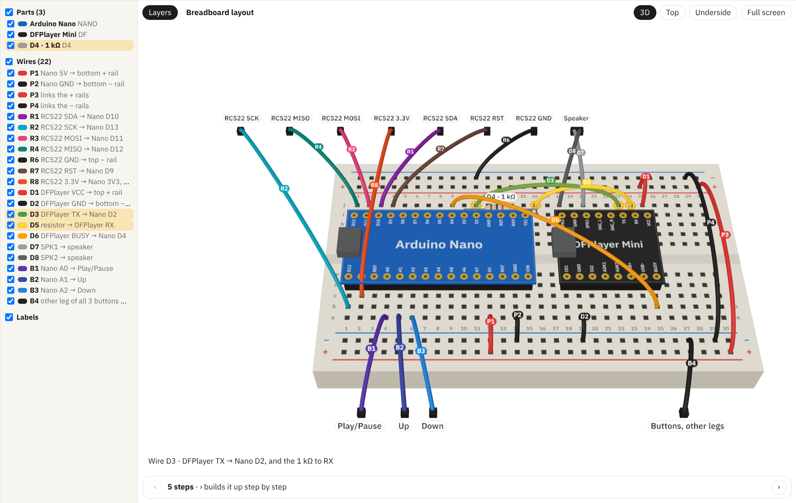

# xi-extensions

Extensions and MCP servers for [Xi](https://github.com/floscr/xi), the
coding agent harness. Each one lives in its own directory and installs on its
own. The list below is also in [`catalog.edn`](catalog.edn), which the Xi
website's extensions page reads.

| Name | Kind | What it does |
| --- | --- | --- |
| [three](mcp/three) | MCP server | Interactive 3D views in the chat: breadboards, perfboards and stripboards wired hole by hole, with build steps and an underside view; plus free-form 3D scenes. The agent can point at wires in an open view, or run squint in it. |



## Installing an MCP server

The servers run on [babashka](https://babashka.org). Clone this repo and add
the server to `~/.config/xi/mcp.edn`, e.g. for `three`:

```clojure
{:three {:command "bb"
         :args ["--config" "/path/to/xi-extensions/mcp/three/bb.edn" "serve"]
         :code-paths ["/path/to/xi-extensions/mcp/three/bb"
                      "/path/to/xi-extensions/mcp/three/src"]}}
```

Then run `/mcp refresh three` in Xi. On the first call Xi asks whether to trust
the server. `:code-paths` makes it ask again after the code changes.

## Layout

```
catalog.edn   what is here, for the Xi website
mcp/<name>/   MCP servers, each with its own bb.edn and README
```

## License

MIT
