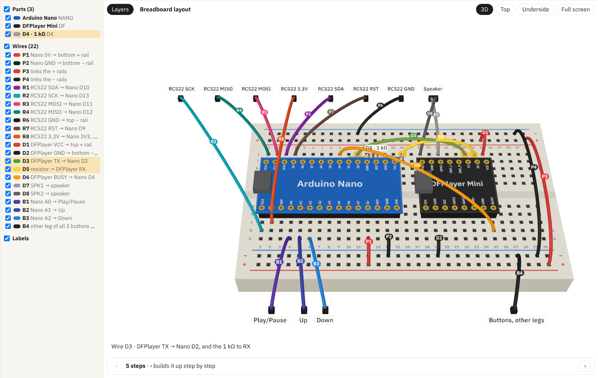
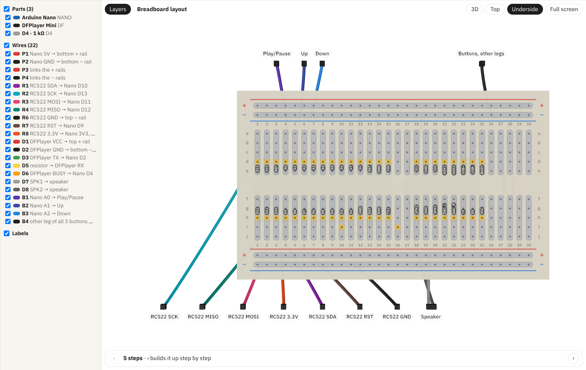
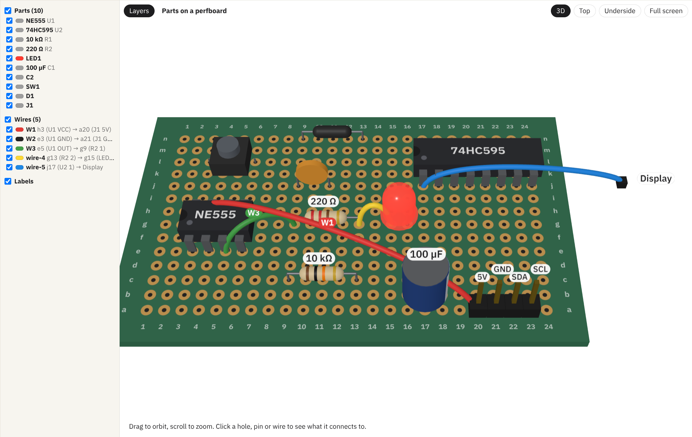
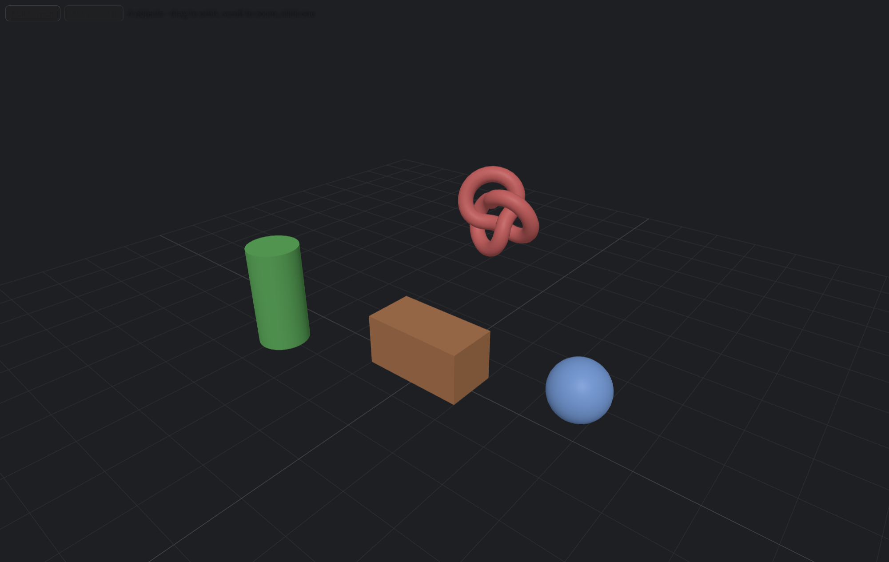

# three: 3D views as an MCP server

A babashka MCP server whose tools show interactive three.js views (MCP Apps) in
xi, or any MCP Apps host. The views are squint, compiled on demand.

- `breadboard_show` / `breadboard_html`: a breadboard, perfboard or stripboard
  with parts and wires, hole by hole, in the chat or in an HTML document.
- `breadboard_target`: highlight, focus, show/hide or step in an open view.
- `breadboard_eval`: run squint in an open view and get the value back.
- `scene_show`: an arbitrary 3D scene of primitive shapes.



| Underside (solder side) | Parts on a perfboard | scene_show |
| --- | --- | --- |
|  |  |  |

## Install

Needs [babashka](https://babashka.org); squint and esbuild come as bb
dependencies, no node. In `~/.config/xi/mcp.edn`:

```clojure
{:three {:command "bb"
         :args ["--config" "/path/to/xi-extensions/mcp/three/bb.edn" "serve"]
         :code-paths ["/path/to/xi-extensions/mcp/three/bb"
                      "/path/to/xi-extensions/mcp/three/src"]}}
```

Then run `/mcp refresh three`. After changing code, run it again: a view's
URI carries its bundle's hash. A changed `bb/` or `src/` also changes the
server's trust fingerprint, so xi asks once more.

The views load three.js and squint's runtime from jsDelivr, so they need the
internet.

## Layout

```
bb/three_mcp/   the server (bb): rpc (concurrent stdio JSON-RPC), build
                (squint + esbuild, dev server), views (compile on demand,
                import map), channels (agent → open views: commands, long
                poll, eval), breadboard, scene
src/three/      the shared squint lib: core (hiccup → three.js, keyed
                re-render), stage (renderer, camera, picking, framing),
                text, dom, host (MCP Apps bridge), live (squint eval in page)
src/breadboard/ model.cljc (read by bb and squint), ui/ (the view)
src/scene/ui/   the scene view
dev/            the dev page
```

Bundles import `three` and `squint-cljs` by name. The import map in
`three-mcp.views` resolves them to jsDelivr, the one host a view's CSP allows.
Pages that embed a board get the same import map.

## Tasks

- `bb dev`: http://localhost:9461/ shows the views on fixtures and reloads on
  save. A REPL box evaluates squint in the page; `window.squintEval(code)`
  does the same for a browser driven by an agent.
- `bb test`: the shared model and the server's HTML splicing.
- `bb build`: compiles every view once, to see that they build.

## Squint notes

- `model.cljc` runs in bb and squint without reader conditionals: no host
  interop, maps and sets aren't called as functions, collections aren't
  compared with `=`.
- A view's CSP has `'unsafe-inline'` but no `'unsafe-eval'`, so live eval
  runs compiled code as an injected inline module script, not `eval`.
- Don't name a local `new`: squint compiles it to a broken `new$` call.
